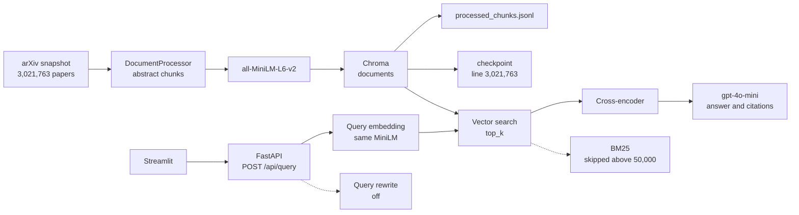

# ArxivLens Architecture

Two pipelines share one Chroma collection. Ingest writes the index. A query reads it, reranks the short list, and asks the chat model for an answer. The full index holds 3,021,763 arXiv papers.

Solid boxes run today. Dashed boxes are in the code and do not run on the full index.

## Ingest

`python main.py --process-data` reads `data/raw/arxiv-metadata-oai-snapshot.json`.

1. `DocumentProcessor` turns each paper into chunks. The embedded text is the abstract. The default splitter is 1,000 characters with 200 characters of overlap. Chunk ids are `{paper id}-{index}`.
2. `EmbeddingModel` embeds each chunk with `all-MiniLM-L6-v2` (384 dimensions).
3. `VectorStore.add_embeddings` writes ids, vectors, text, and scalar metadata into the Chroma collection `documents` under `data/vector_store/`.
4. The same batch is appended to `data/processed/processed_chunks.jsonl`.
5. `data/processed/ingest_checkpoint.json` stores how many source lines have been consumed. The next run skips lines below that count. A replaced snapshot is not a delta of new papers.

`main.py` is either ingest or the API. One process does not do both.

## Query

`streamlit_app.py` posts `query` and `top_k` to `POST /api/query`.

1. `LLMInterface.rewrite_query` returns the original query while `ENABLE_QUERY_REWRITE=false`.
2. The query is embedded with the same MiniLM model.
3. `VectorStore.query` runs a Chroma vector search and returns `top_k` chunks. Year bounds are pushed into the Chroma `where` clause. Author and category filters are applied in Python after the search.
4. `CrossEncoderReranker` reranks that list with `cross-encoder/ms-marco-MiniLM-L-6-v2`. It stores `reranker_score_raw` and a 0–1 `reranker_score`. Chunks whose raw score is below `RERANKER_MIN_RAW_SCORE` are removed. A raw score near 0 goes away. A raw score around 5 stays. The kept list is cut to `top_k`.
5. Facet counts for year, category, and author are computed from the kept chunks only.
6. If no chunks remain, the API skips the model and returns “I do not have enough information in the provided context.” with no citations. Otherwise `gpt-4o-mini` still sees chunks as `[Document N]` in the prompt. The API checks that each quote appears in that chunk, then adds the arXiv id (`metadata.doc_id`), chunk id, and title to the citation. The app opens `https://arxiv.org/abs/{id}` from that id.

The response body is `answer`, `citations`, `context_chunks`, `facets`, `query`, and `rewritten_query`.

Other routes: `GET /`, `GET /api/health`, `GET /api/readiness`.

## Not active on the full index

- **BM25.** `VectorStore` can fuse vector scores with an in-memory `BM25Okapi` index. Building that index is skipped when the collection is larger than `HYBRID_BM25_MAX_DOCS` (50,000). Every query on the full store is vector-only, so `bm25_score` stays 0.
- **Query rewrite.** The rewriter is implemented and defaults to on if the env var is missing. `.env` sets `ENABLE_QUERY_REWRITE=false`. `QUERY_REWRITE_MODEL` is unused in that state.

## Directory ownership

| Path | Role |
| --- | --- |
| `main.py` | Ingest or API process |
| `streamlit_app.py` | Query UI |
| `src/data_processing` | Load papers and chunk abstracts |
| `src/embeddings` | MiniLM embeddings |
| `src/vector_store` | Chroma reads and writes, BM25, facets |
| `src/reranker` | Cross-encoder rerank |
| `src/llm` | Query rewrite, answer, citation check |
| `src/api` | FastAPI routes |
| `data/raw` | Source snapshot |
| `data/vector_store` | Chroma index |
| `data/processed` | Checkpoint and chunk sidecar |
