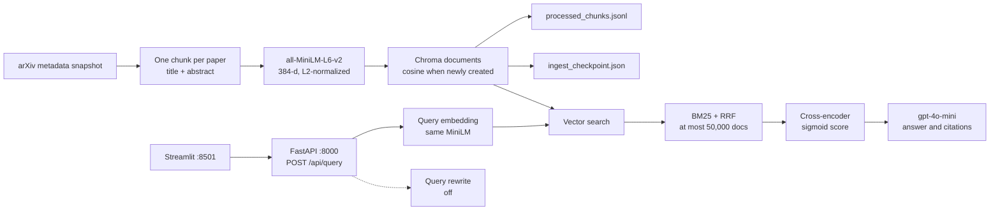

# ArxivLens Architecture

Two pipelines share one Chroma collection. Ingest writes the index. A query reads it, reranks the short list, and asks the chat model for an answer.

The live index is `data/vector_store_corpus`: 5,000 papers, one chunk each. The optional full archive is `data/vector_store`. The app opens whichever directory `VECTOR_STORE_DIR` names.

The solid path runs on the live corpus. The dashed rewrite step is in the code and returns the original query while `ENABLE_QUERY_REWRITE=false`. BM25 is skipped when the collection is larger than `HYBRID_BM25_MAX_DOCS` (50,000), which is the case for the full archive.

## Ingest

`python main.py --process-data` reads `data/raw/arxiv-metadata-oai-snapshot.json`. `main.py` is either ingest or the API. One process does not do both.

1. `DocumentProcessor` writes one chunk per paper. The stored text is the title, a blank line, and the full abstract. The chunk id is `{paper id}-0`. Empty text is skipped.
2. `EmbeddingModel` embeds that text with `all-MiniLM-L6-v2` (384 dimensions) and L2-normalizes the vector. The model keeps 256 tokens. Title plus abstract past that limit is split into windows with `EMBEDDING_WINDOW_OVERLAP_TOKENS` tokens of overlap (default 32), averaged by window length into the one vector for that paper. The stored chunk text stays the full title and abstract.
3. `VectorStore.add_embeddings` writes ids, vectors, text, and scalar metadata into the Chroma collection `documents`. A collection created by this code uses cosine distance (`hnsw:space=cosine`). `vector_score` is then cosine similarity, `1 - distance`. An existing collection is left in place. If its metadata space is not cosine, including when the space is unset, search still runs and `vector_score` is `1 / (1 + distance)`.
4. `year` is the first submission year: the earliest `versions` `created` date, then the year in a modern arXiv id (`YYMM` means `2000 + YY`), then the year of `update_date`. `updated_year` is the year of `update_date`. `INGEST_YEAR_MIN` filters on the id year when that year is present, so a 2024 id can be stored with `year` 2023. Of the 5,000 live papers, 273 have `year` 2023 and 4,727 have `year` 2024. Every one lists `cs.CL` or `cs.LG`.
5. The same batch is appended to `{OUTPUT_DIR}/processed_chunks.jsonl`.
6. `{OUTPUT_DIR}/ingest_checkpoint.json` stores how many source lines have been consumed (`processed_docs` is a line count, not a paper count). The next run skips lines below that count. `RESET_INGEST=true` deletes the checkpoint and the sidecar. It does not delete the Chroma directory. A replaced snapshot is not a delta of new papers.

## Query

`streamlit_app.py` posts `query`, `top_k`, and optional author, category, and year filters to `POST /api/query`.

1. `LLMInterface.rewrite_query` returns the original query. `ENABLE_QUERY_REWRITE` defaults to false.
2. The query is embedded with the same MiniLM model and L2-normalized.
3. `VectorStore.query` runs a Chroma vector search. Year bounds filter on metadata `year` in the Chroma `where` clause and again in Python. Author and category filters are applied in Python after the search. The search asks for more neighbors than `top_k` so one chunk per paper can still fill the list.
4. On a collection of at most 50,000 documents, vector rank and BM25 rank are fused with reciprocal rank fusion (`RRF_K`, default 60). `hybrid_score` is that fusion score. Above 50,000 documents the BM25 index is not built, `bm25_score` stays 0, and ranking is vector-only. The live corpus is under that cap, so hybrid search runs.
5. `CrossEncoderReranker` reranks up to `RERANKER_MAX_CANDIDATES` (24) chunks with `cross-encoder/ms-marco-MiniLM-L-6-v2`. It stores `reranker_score_raw` (the logit) and `reranker_score` as the sigmoid of that logit, so the 0–1 score means the same thing on every query. Chunks whose raw score is below `RERANKER_MIN_RAW_SCORE` (1) are removed. A raw score near 0 goes away. A raw score around 5 stays. The kept list is cut to `top_k`.
6. Facet counts for year, category, and author are computed from the kept chunks only.
7. If no chunks remain, the API skips the model and returns "I do not have enough information in the provided context." with no citations. Otherwise `gpt-4o-mini` sees chunks as `[Document N]` and returns a one-sentence summary plus a list of points. Each point has a short title, one or two sentences, and the document numbers that support it. The API keeps only numbers that match a retrieved chunk and attaches that paper's title and arXiv id. The app shows the summary, then one row per point, with each paper title linking to `https://arxiv.org/abs/{id}`. `answer` is the same text as a plain string. The API also checks that each citation quote appears in that chunk, then adds the arXiv id (`metadata.doc_id`), chunk id, and title.

The response body is `answer`, `summary`, `points`, `citations`, `context_chunks`, `facets`, `query`, and `rewritten_query`.

Other routes: `GET /`, `GET /api/health`, `GET /api/readiness`.

## Indexes on disk

The live collection was created with cosine distance (`hnsw:space=cosine`), so `vector_score` is `1 - distance`. The full archive still records HNSW space `l2` and does not store `hnsw:space` in collection metadata, so it keeps the legacy score until it is re-ingested into a new collection.

| Index | Path | What is stored |
| --- | --- | --- |
| Live corpus | `data/vector_store_corpus` | 5,000 chunks, one per paper, ids ending in `-0`, cosine distance. Embeddings use the windowed MiniLM vectors. The checkpoint in `data/processed_corpus` has consumed 23,795 source lines. |
| Full archive | `data/vector_store` | Optional. The checkpoint in `data/processed` has consumed 3,021,763 source lines. The collection still holds 5,209,090 chunk ids from the older multi-chunk ingest, 3,021,737 of them ending in `-0`. Distance is L2. BM25 stays off. |

## Directory ownership

| Path | Role |
| --- | --- |
| `main.py` | Ingest or API process |
| `streamlit_app.py` | Query UI |
| `src/data_processing` | Load papers and build one chunk per paper |
| `src/embeddings` | MiniLM embeddings |
| `src/vector_store` | Chroma reads and writes, cosine or legacy L2 score, BM25, facets |
| `src/reranker` | Cross-encoder rerank and sigmoid score |
| `src/llm` | Query rewrite, answer, citation check |
| `src/api` | FastAPI routes |
| `src/ui` | Paper cards in the Streamlit app |
| `data/raw` | Source snapshot |
| `data/vector_store_corpus` | Live Chroma index |
| `data/vector_store` | Optional full-archive index |
| `data/processed_corpus` | Live checkpoint and chunk sidecar |
| `data/processed` | Full-archive checkpoint and chunk sidecar |
